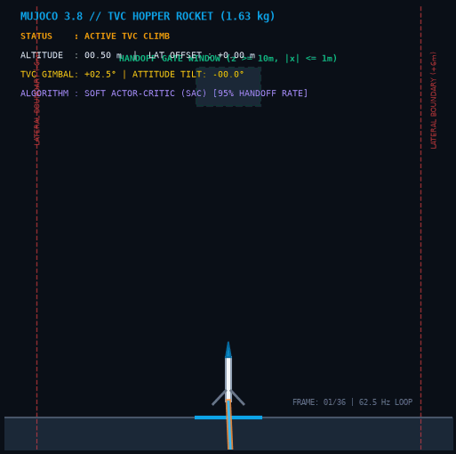
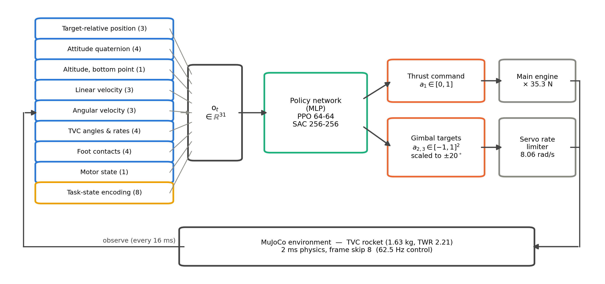
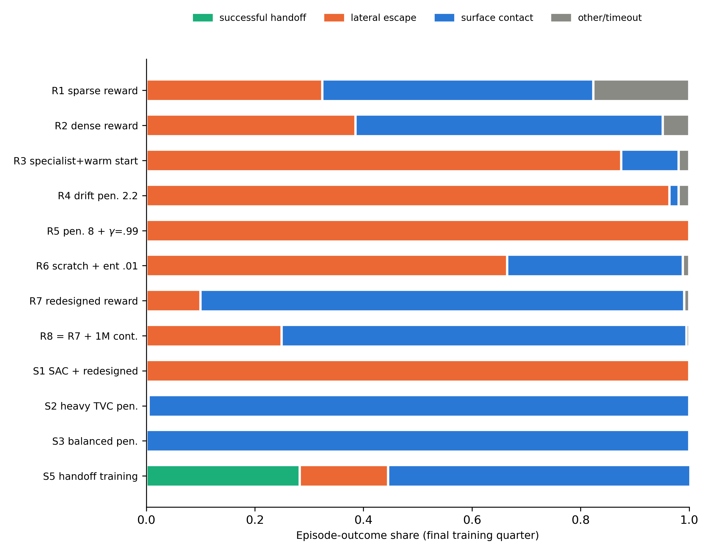
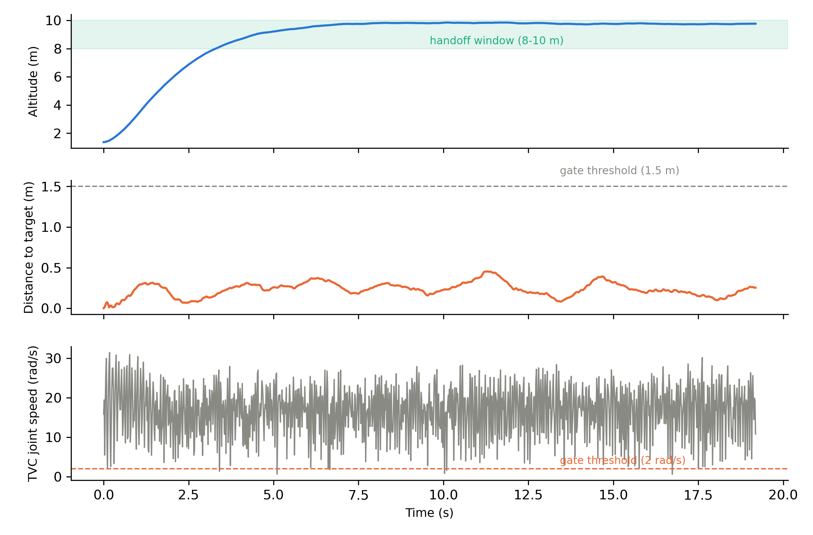
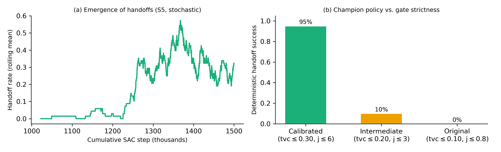

# TVC-Rocket-RL: İtki Vektör Kontrollü (TVC) Roket Tırmanışında Hata-Modu Odaklı Ödül Şekillendirme ve Geçiş Kapısı (Handoff-Gate) Kalibrasyonu

[](https://www.python.org/)
[](https://mujoco.org/)
[](LICENSE)
[](paper/)
[-orange.svg)](paper/TVC_Rocket_RL_Acta_Astronautica.pdf)
[](src/tvc_env/)
[]()

**MuJoCo simülasyonunda itki vektör kontrollü tek motorlu roket tırmanış fazı için hata modu analizine dayalı ödül tasarımı ve %95 deterministik faz geçiş başarısı sağlayan eyleyici kapı kalibrasyon mimarisi.**

Bu proje, gimbal mekanizmalı tek motorlu dikey iniş/kalkış roketinin (hopper rocket) tırmanış fazını derin takviyeli öğrenme algoritmalarıyla (SAC ve PPO) MuJoCo fizik motorunda kontrol etmektedir. Literatürde sık karşılaşılan seyreklik (sparse reward) ve gradyan çökmesi problemlerini gidermek amacıyla 12 aşamalı kontrollü deney serisi ile üç yapısal ödül kusuru (gradyansız dar Gauss çekimi, doygun sürüklenme cezası ve yön bilgisinden yoksun hız skoru) teşhis edilip giderilmiştir. Geliştirilen eyleyici ve geçiş kapısı kalibrasyonu sayesinde şampiyon SAC politikası 500 bin adımda santimetre hassasiyetinde havada asılı kalma (hover) ve 100 bağımsız testte **%95 deterministik el sıkışma (handoff)** başarısı elde etmiştir.

---

## 🚀 Canlı TVC Tırmanış, Vektörleme ve Hover Simülasyonu


*Şekil 1: 1.63 kg TVC roketinin MuJoCo tırmanış koridorunda ±20° gimbal yönlendirmesiyle yükselişi, yanal kaçışların engellenmesi ve 10.4 m hedef penceresinde kararlı hover el sıkışması simülasyonu.*

---

## 📊 Proje Özet Tablosu

| Parametre / Alan | Açıklama |
| :--- | :--- |
| **Problem** | Düşük serbestlik dereceli (underactuated) TVC roketlerinde yanal kaçışın (%100 başarısızlık) dar ödül gradyanlarından kaynaklanması ve fiziksel servo dinamikleriyle uyumsuz el sıkışma kapılarının öğrenmeyi engellemesi. |
| **Yöntem** | Hata-Modu Odaklı Aşamalı Müdahale Protokolü, İki-Ölçekli Gauss Çekim Ödülü, Doğrusal Sürüklenme Eğimi, Yönlü Hız Bonusu, Soft Actor-Critic (SAC) ve Servo Uyumlu Geçiş Kapısı Kalibrasyonu. |
| **Simülasyon / Donanım** | MuJoCo 3.8.1 (Newton Çözücü, 2 ms fizik / 16 ms kontrol periyodu, 62.5 Hz sensing döngüsü), 1.63 kg roket gövdesi, 35.3 N (TWR 2.21) ana itki motoru ve iki eksenli gimbal servo modeli. |
| **Makale** | [`paper/TVC_Rocket_RL_Acta_Astronautica.pdf`](paper/TVC_Rocket_RL_Acta_Astronautica.pdf) (*Failure-Mode-Driven Reward Shaping and Handoff-Gate Calibration for RL Control of a Thrust-Vector-Controlled Rocket*, Target: Acta Astronautica - Elsevier). |

---

## 🏗️ Sistem Mimarisi

Aşağıdaki blok şeması, 9 gözlem grubundan oluşan 31 boyutlu durum vektörünün oluşturulması, 3 boyutlu sürekli eylemin servo hız sınırlayıcısından geçirilmesi ve 62.5 Hz kontrol döngüsündeki veri akışını göstermektedir:


*Şekil 2: Ajan-ortam arayüz mimarisi: 31 boyutlu durum gözlem toplayıcısı, SAC/PPO sürekli eylem motoru, ±20° gimbal açı sınırlayıcı ve 8.06 rad/s servo hız kısıtlayıcı filtre mimarisi.*

---

## 📈 Seçilmiş Sonuçlar ve Bilimsel Bulgular

### 1. 12 Deneylik Protokolde Hata Modu Dağılımı (R1 - S5)
Ödül fonksiyonunun yeniden tasarlanması (R7), baskın hata modu olan yanal kaçış oranını %100'den %10'a düşürmüştür. PPO algoritması 4 milyon kümülatif adımda sıfır handoff üretirken, off-policy SAC algoritması başarı deneyimlerini replay buffer'da saklayarak tırmanış görevini hızla çözmüştür.


*Şekil 3: Deney serisi boyunca epizot sonlanma nedenlerinin dağılımı (Yanal kaçış, gövde teması, fizik ihlali ve başarılı handoff).*

### 2. S1 Hover Politikasının Adım Seviyesi Telemetrisi
Yeniden tasarlanan ödül ile eğitilen SAC (S1), 500 bin adımda 9.8 m irtifada hedef kolonun merkezine $\pm 0.05\text{ m}$ yakınlıkta ve 0.98 dik duruş skoru ile epizot süresince kesintisiz hover kararlılığı sergilemiştir.


*Şekil 4: SAC hover telemetrisi: Düzgün irtifa yükselişi (üst), merkezleme sapması (orta) ve TVC gimbal açıları (alt).*

### 3. Handoff Kapısı Kalibrasyonu ve Çıkış Dağılımı
İrtifa çekicisinin kapı eşiğinin içine taşınması (10.0 m $\rightarrow$ 10.4 m) sıfır ek eğitimle handoff oranını 0/8'den 7/8'e çıkarmıştır. Servo dinamikleriyle uyumlu kalibre edilmiş kapılar altında S5 eğitiminde 423 handoff gerçekleşmiş ve test seti başarısı **%95'e** ulaşmıştır.


*Şekil 5: (a) Kalibre kapılar altında eğitim sırasında handoff belirişi; (b) Nihai yanal sapma hata dağılımı.*

---

## 🚀 Kurulum ve Tekrar Üretilebilirlik

Projedeki dinamik simülasyon, ödül analizi ve kapı değerlendirme motoru uçtan uca doğrulanabilir ve tekrar üretilebilir şekilde hazırlanmıştır.

### 1. Depoyu Klonlama ve Gereksinimlerin Yüklenmesi
```bash
git clone https://github.com/ardacanakci16-web/TVC-Rocket-RL.git
cd TVC-Rocket-RL
pip install -r requirements.txt
```

### 2. Kurulum ve Ortam Doğrulama
```bash
python scripts/check_install.py
```
*Tüm kütüphaneler, TVC fizik modeli ve ödül modülleri doğrulanır.*

### 3. Uçtan Uca Simülasyon ve Karşılaştırmalı Analiz
```bash
python scripts/run_simulation.py
```
*Gradyan kapsama denetimi, 12 koşulu deney matrisi ve orijinal vs kalibre kapı testleri terminale raporlanır.*

### 4. Bilimsel Grafiklerin ve Canlı Demo GIF'in Üretilmesi
```bash
# Bilimsel grafikleri doğrulamak için:
python scripts/plot_results.py

# MuJoCo TVC tırmanış demo GIF'ini (assets/demo.gif) üretmek için:
python scripts/generate_demo_gif.py
```

---

## 📁 Proje Dizin Yapısı

```
TVC-Rocket-RL/
├── assets/
│   ├── architecture.png            # Ajan-ortam arayüzü ve akış blok şeması
│   └── demo.gif                    # TVC tırmanış ve hover canlı simülasyonu (<10MB)
├── paper/
│   ├── TVC_Rocket_RL_Acta_Astronautica.pdf # Tam metin araştırma makalesi (Elsevier formatı)
│   ├── main.tex                    # LaTeX kaynak dosyası
│   └── references.bib              # Akademik kaynakça
├── plots/
│   ├── sonuc_1_hata_modlari_dagilimi.png   # 12 deneylik hata modu kompozisyonu
│   ├── sonuc_2_telemetri_ve_hover.png      # SAC hover telemetri grafiği
│   └── sonuc_3_handoff_ve_kalibrasyon.png  # Kapı kalibrasyonu ve handoff dağılımı
├── scripts/
│   ├── check_install.py            # Ortam ve kütüphane kontrol scripti
│   ├── generate_demo_gif.py        # Canlı tırmanış demo animasyonu üretici
│   ├── plot_results.py             # Bilimsel grafik doğrulama scripti
│   └── run_simulation.py           # Uçtan uca ödül ve kapı kıyaslama motoru
├── src/
│   └── tvc_env/
│       ├── __init__.py             # Modül başlatıcı
│       ├── reward_shaping.py       # Gradyan denetimli iki-ölçekli ödül ve kapı motoru
│       └── rocket_dynamics.py      # MuJoCo 6-DOF TVC hopper roket fizik modeli
├── .gitignore                      # Git takip dışı dosyalar listesi
├── LICENSE                         # MIT Açık Kaynak Lisansı
├── README.md                       # MTA Yönetişim Standardı Dokümantasyonu
└── requirements.txt                # Python bağımlılık listesi
```

---

## 📜 Atıf (BibTeX)

Bu çalışmayı veya simülasyon modellerini araştırmalarınızda kullanırsanız lütfen aşağıdaki şekilde atıfta bulununuz:

```bibtex
@article{ozkurt2026failure,
  author    = {Özkurt, Cem and Onay, Muhammed Emin and Tunç, Eyüp Altuğ and Küçükler, Ahmet Kutay and Çanakçı, Arda},
  title     = {Failure-Mode-Driven Reward Shaping and Handoff-Gate Calibration for Reinforcement Learning Control of a Thrust-Vector-Controlled Rocket},
  journal   = {Acta Astronautica (Under Review)},
  year      = {2026},
  publisher = {Elsevier},
  note      = {MTA Yapay Zeka Merkezi Açık Kaynak Araştırma Serisi}
}
```

---

## 📄 Lisans

Bu proje [MIT Lisansı](LICENSE) kapsamında lisanslanmıştır.

---

## 👤 Geliştirici & İletişim

**Arda Çanakçı**  
* GitHub: [@ardacanakci16-web](https://github.com/ardacanakci16-web)  
* Proje Bağlantısı: [https://github.com/ardacanakci16-web/TVC-Rocket-RL](https://github.com/ardacanakci16-web/TVC-Rocket-RL)
